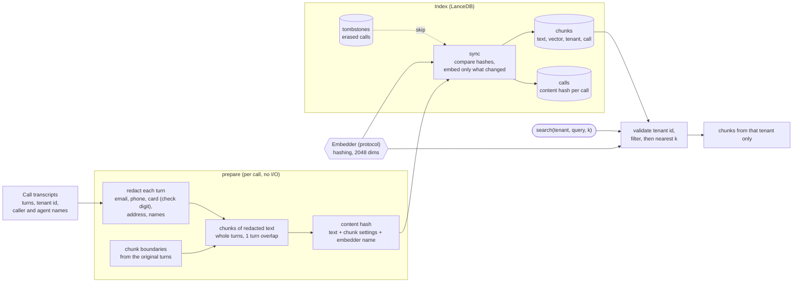
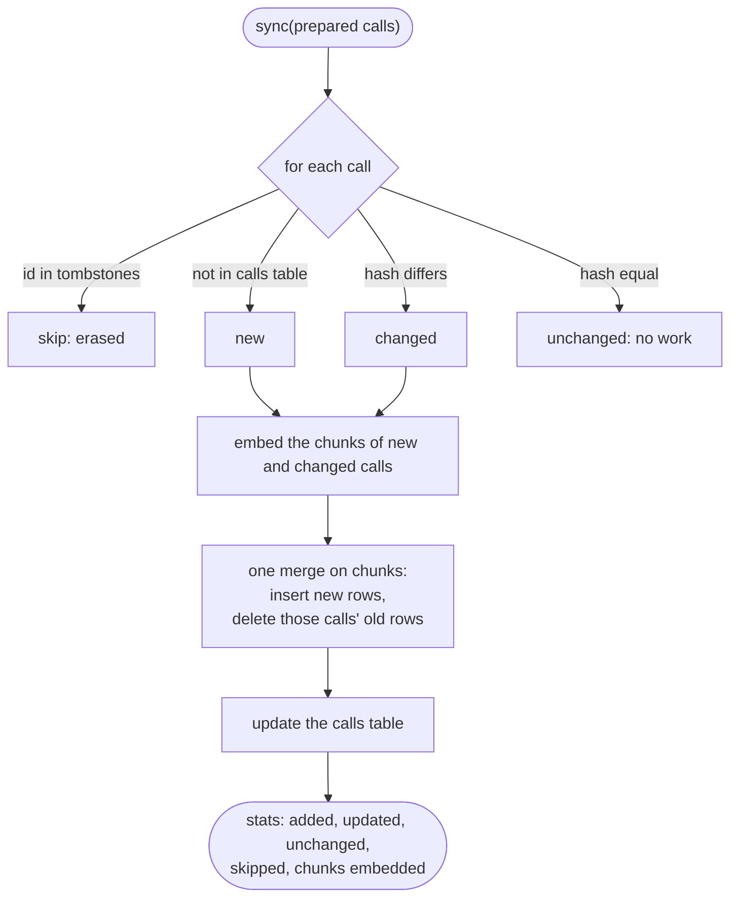
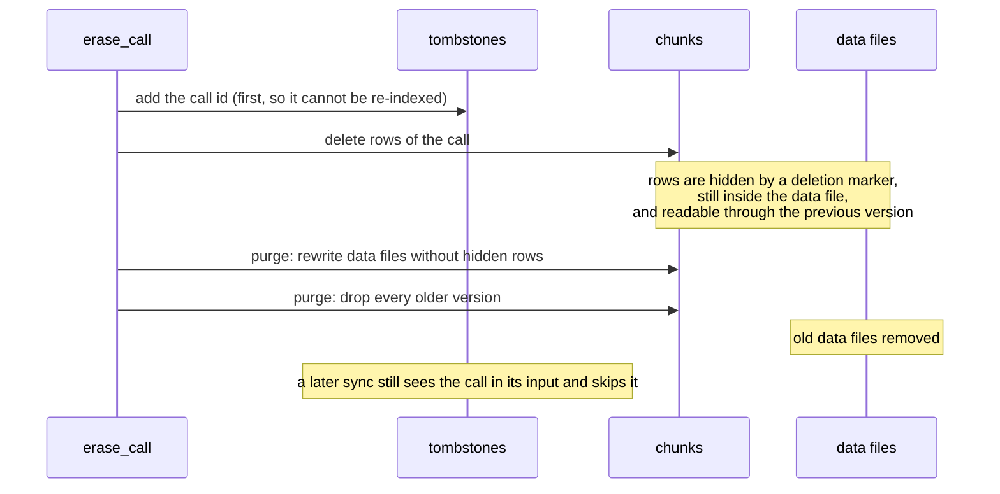

# Architecture

Calls go in as transcripts with a tenant id. What comes out is a LanceDB index of redacted
chunks that can only be searched one tenant at a time.

## The pipeline

Raw text never reaches the index. `prepare` returns redacted chunks, and `Index` accepts only
what `prepare` returns.

## One sync

The chunk replacement is a single commit. The `calls` table is updated after it. If the process
stops between the two, the next sync sees the old hash and does the same replacement again,
which gives the same result.

## Erasure

## Modules

| Module | Does |
|---|---|
| `synth.py` | Generates calls and the answer key of planted personal information |
| `redact.py` | Finds and replaces personal information |
| `prepare.py` | Redacts and chunks one call; computes its content hash |
| `embed.py` | The embedder protocol and the hashing embedder |
| `index.py` | Sync, search, erase and purge on LanceDB |
| `evaluate.py` | Scores redaction, retrieval, isolation and incremental sync; writes the report |
